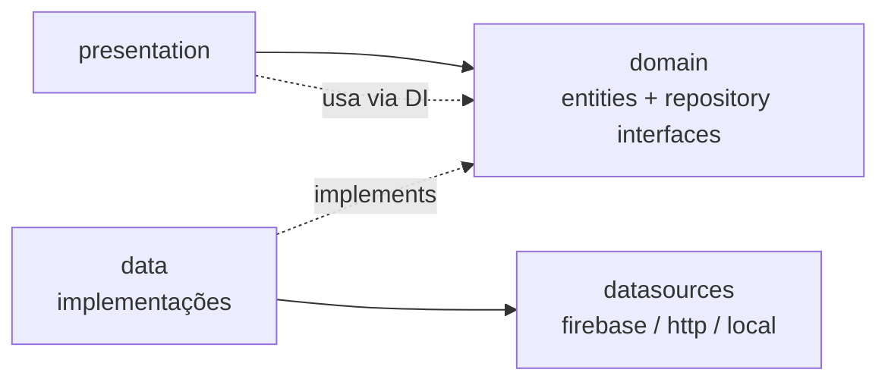

# 🛒 CestaFácil

> Aplicativo mobile/Web para organizar compras de mercado, comparar preços com inteligência e descobrir receitas que combinam com o que você já tem em casa.

---

## 📖 Visão do Produto

O **CestaFácil** nasceu para resolver três dores do dia a dia de quem faz compras:

1. **Lista de compras inteligente** — monte sua lista a partir de um catálogo de produtos e/ou crie produtos personalizados.
2. **Comparador de preços** — descubra qual embalagem realmente compensa (ex.: 2×500 g a R$ 4,50 vs. 1 kg a R$ 10,00).
3. **Receitas integradas** — veja receitas que combinam com os itens da sua lista, e adicione ingredientes faltantes direto na lista.

---

## ✨ Funcionalidades

### 1. Lista de Compras `(em desenvolvimento)`

- Buscar produtos já cadastrados no catálogo (servidor).
- Adicionar produtos do catálogo à lista com quantidade e unidade.
- Criar **produtos locais** (personalizados) que se misturam aos do catálogo.
- Marcar itens como comprados (com quantidade comprada e preço pago — preparando o módulo de preços).
- Compartilhar lista com parceiro(a) / família em tempo real.
- Funcionamento **offline-first**: lista e produtos locais continuam funcionando sem internet.
- Contribuir produtos locais para o catálogo global (fluxo de moderação no servidor).

### 2. Comparador de Preços `(planejado)`

- Compara produtos **por unidade de medida** (R$/kg, R$/L, R$/un).
- Normaliza automaticamente unidades (g ↔ kg, ml ↔ L).
- Sugere "comprar N unidades para igualar" (ex.: 2×500 g = 1 kg).
- Considera preço pago em compras anteriores quando disponível.

### 3. Receitas `(planejado)`

- Catálogo de receitas em geral.
- **Match com a lista**: receitas que usam os itens da sua lista atual.
- Detalhe da receita: ingredientes, modo de preparo, rendimento.
- Adicionar ingredientes faltantes à lista de compras com um toque.

---

## 🎯 Princípios de Projeto

| Princípio | Aplicação |
|---|---|
| **Offline-first** | SQLite local é a fonte primária; sincronização é opcional e não bloqueante. |
| **Backend-agnóstico** | Domínio e UI não conhecem Firebase. Repositórios são interfaces; implementações são plugáveis. |
| **Pronto para API REST futura** | Toda comunicação remota fica isolada em `data/datasources/remote/`. |
| **i18n desde o início** | Strings em ARB; `intl` para datas, números e moeda. pt-BR base, preparado para en/es. |
| **Testes no domínio** | Regras de negócio (unidades, preços, match de receitas) testáveis sem UI nem backend. |

---

## 🏗️ Arquitetura

Arquitetura em camadas inspirada em **Clean Architecture** + **feature-first**.

```
lib/
├── main.dart
├── app/                         # Bootstrap, MaterialApp, tema, rotas, localização
│   ├── app.dart
│   ├── router/
│   ├── theme/
│   └── l10n/
├── core/                        # Código transversal (sem regras de negócio de feature)
│   ├── error/                   # AppException, Failure, Result<T>
│   ├── di/                      # Providers raiz (onde se escolhe Firebase × REST)
│   ├── units/                   # Conversão de unidades (kg/g/L/ml/un)
│   ├── money/                   # Formatação e cálculo de custo unitário
│   ├── utils/                   # Helpers, normalização de strings
│   └── constants/
├── features/
│   ├── auth/
│   │   ├── domain/              # User, AuthRepository (abstrato)
│   │   ├── data/                # Firebase Auth (hoje) | REST (futuro)
│   │   └── presentation/
│   ├── catalog/
│   │   ├── domain/              # Product, ProductRepository, SearchQuery
│   │   ├── data/
│   │   │   ├── datasources/
│   │   │   │   ├── remote/
│   │   │   │   │   ├── firestore_product_data_source.dart
│   │   │   │   │   └── http_product_data_source.dart      # futuro
│   │   │   │   └── local/
│   │   │   │       └── drift_product_cache.dart
│   │   │   ├── models/          # DTOs + mappers
│   │   │   └── repositories/
│   │   └── presentation/
│   ├── shopping_list/           # 🔥 Módulo 1 — em desenvolvimento
│   ├── price_compare/           # Módulo 2 — planejado
│   ├── recipes/                 # Módulo 3 — planejado
│   └── profile/                 # Conta do usuário e preferências
└── shared/                      # Widgets e Design System reutilizáveis
    ├── widgets/
    └── extensions/
```

### Fluxo de dependência



> A UI **nunca** importa `cloud_firestore`, `dio` ou `drift`.
> Trocar o backend = criar um novo `*Repository`/`DataSource` e mudar **um provider**.

### Camadas explicadas

- **domain** — entidades puras + contratos de repositório. Zero dependência externa.
- **data** — DTOs, mappers e implementações de repositório que combinam datasources.
- **presentation** — widgets, providers (Riverpod) e estado de tela.

Detalhes técnicos adicionais em [`docs/ARCHITECTURE.md`](docs/ARCHITECTURE.md).

---

## 🗄️ Modelo de Dados

### Catálogo (remoto — Firestore hoje, API amanhã)

```dart
Product {
  String id;                          // UUID gerado no cliente
  String name;                        // "Arroz branco"
  Map<String, String> names;          // i18n: {'pt':'Arroz branco','en':'White rice'}
  List<String> aliases;               // busca: ['arroz','arroz tipo 1']
  String? barcode;
  String? brand;
  String category;
  Unit defaultUnit;                   // kg, g, L, ml, un, dz, pct...
  String? imageUrl;
}
```

### Produto local (dispositivo — SQLite/Drift)

```dart
LocalProduct {
  String localId;                     // UUID
  String ownerUid;
  String name;
  String category;
  Unit unit;
  SyncStatus syncStatus;              // local | pendingUpload | synced | rejected
  String? catalogId;                  // preenchido após validação no servidor
  DateTime createdAt;
  DateTime? lastSyncedAt;
}
```

### Lista de compras (Firestore, compartilhável)

```dart
ShoppingList {
  String id;                          // UUID
  String ownerUid;
  String name;
  List<ListMember> members;           // {uid, role: owner|editor|viewer}
  DateTime createdAt;
  DateTime updatedAt;
}

ShoppingItem {
  String id;                          // UUID
  String listId;
  ProductRef product;                 // {type: catalog|local, id}
  String name;
  double quantity;
  Unit unit;
  double? expectedUnitPrice;          // preço estimado
  bool checked;
  String? checkedByUid;
  double? purchasedQuantity;          // qtd efetivamente comprada
  double? paidPrice;                  // preço pago (alimenta comparador futuro)
  String addedByUid;
  DateTime createdAt;
  DateTime? checkedAt;
}
```

### Comparador de preços

```dart
PriceOffer {
  String label;                       // "Arroz 1kg – Marca X"
  double price;                       // R$
  double size;                        // 1.0
  Unit unit;                          // kg
}

ComparisonResult {
  PriceOffer cheaper;
  PriceOffer expensive;
  double cheaperCostPerBaseUnit;      // R$/kg
  double expensiveCostPerBaseUnit;
  double percentSavings;
  int? unitsToMatch;                  // ex.: 2 unidades de 500g = 1kg
  double? costToMatch;                // R$ 9,00
}
```

### Receitas

```dart
Recipe {
  String id;
  Map<String, String> names;          // i18n
  String? imageUrl;
  int servings;
  List<RecipeIngredient> ingredients; // {name, qty, unit, optional}
  Map<String, List<String>> steps;     // i18n
  List<String> tags;                   // ['vegetariano','rápido']
}
```

---

## 🔄 Estratégia de Backend

### Fase atual: **Frontend-first com contratos**

O backend é construído **depois** que os modelos de domínio estabilizarem. Motivo:

- A UI é escrita **contra as interfaces de repositório** — elas são a especificação do backend.
- O módulo 1 (lista) é quase todo local (SQLite).
- Evita redesenhos no Firestore antes de saber exatamente o que a UI precisa.

### Backend planejado (Fase 4)

| Necessidade | Solução inicial | Migração futura |
|---|---|---|
| Auth (email, Google, Apple) | **Firebase Auth** | JWT em API própria |
| Listas compartilhadas (tempo real) | **Firestore listeners** | WebSocket / Supabase Realtime |
| Catálogo (busca, filtros) | **Cloud Function** (`searchProducts`) | REST/GraphQL + Postgres |
| Contribuição de produtos | **Cloud Function** (`contributeProduct`) | Endpoint REST |
| Notificações | **Firebase Cloud Messaging** | — (provavelmente permanece) |

> **Busca via Cloud Function desde o início** = o app já fala com uma "API funcional". Amanhã, trocar a Function por um endpoint HTTP não muda o app.

### Estratégia de migração Firebase ➜ API

O que torna a troca indolor:

- IDs `String` (UUID gerado no cliente — não depende de IDs do Firestore).
- Domínio nunca expõe `Timestamp`/`DocumentSnapshot` — sempre `DateTime`/entidades próprias.
- Erros padronizados (`AppException`) — `FirebaseException`/`DioException` são traduzidos na camada `data`.
- Paginação/ordenação como contrato (`page`, `pageSize`, `sortBy`) traduzidos internamente.
- Streams como contrato (`watchList`, `watchCatalog`) — REST pode ser polling/WebSocket atrás disso.
- Repositórios alternativos (`RestProductRepository`) implementando as mesmas interfaces.
- `MockProductRepository` e `InMemoryShoppingListRepository` prontos para testes de UI sem backend.

---

## 🧰 Stack Técnica

| Área | Escolha | Status |
|---|---|---|
| Framework | Flutter 3.47 / Dart 3.13 | ✅ |
| Estado / DI | `flutter_riverpod` | 🟡 a configurar |
| Navegação | `go_router` | 🟡 a configurar |
| Banco local | `drift` (SQLite) | 🟡 a configurar |
| Imutabilidade/Modelos | `freezed` + `json_serializable` | 🟡 a configurar |
| i18n | `flutter_localizations` + `intl` + ARB | 🟡 a configurar |
| IDs | `uuid` | 🟡 a configurar |
| Backend (fase 4) | Firebase (`core`, `auth`, `firestore`, `functions`) | ⬜ |
| HTTP (futuro) | `dio` | ⬜ |

---

## 🗺️ Roadmap

### ✅ Fase 0 — Fundação
- [x] Criar projeto Flutter (`android`, `ios`, `web`).
- [x] README + documentação de arquitetura.
- [ ] Configurar dependências e `analysis_options`.
- [ ] Estrutura de pastas `core/`, `features/`, `shared/`.
- [ ] Tema, rotas (`go_router`) e `l10n` (pt-BR base).

### 🚧 Fase 1 — Módulo Lista de Compras (100% local)
- [ ] Entidades de domínio: `Product`, `ShoppingList`, `ShoppingItem`, `LocalProduct`.
- [ ] `MockProductDataSource` (catálogo semente ~30 produtos).
- [ ] `ProductRepository` + `MockProductRepository`.
- [ ] SQLite (Drift) para produtos locais e listas.
- [ ] Tela de catálogo com busca e filtro por categoria.
- [ ] Tela da lista: adicionar, editar quantidade, marcar comprado, remover.
- [ ] Criar produto local e adicioná-lo à lista.
- [ ] Testes de domínio e de repositório.

### ⬜ Fase 2 — Comparador de Preços
- [ ] Engine de normalização de unidades.
- [ ] Cálculo de custo por unidade base.
- [ ] UI de comparação com sugestão de "comprar N unidades".
- [ ] Testes com casos reais (500 g × 2 vs. 1 kg etc.).

### ⬜ Fase 3 — Receitas
- [ ] Entidade `Recipe` + dados mock.
- [ ] Cálculo de match com itens da lista.
- [ ] Tela de listagem e detalhe da receita.
- [ ] "Adicionar ingredientes faltantes à lista".

### ⬜ Fase 4 — Backend
- [ ] Projeto Firebase + `flutterfire configure`.
- [ ] Auth (e-mail, Google, Apple).
- [ ] Firestore: listas compartilhadas em tempo real.
- [ ] Sincronização SQLite ➜ Firestore (fila + `sync_status`).
- [ ] Cloud Functions: `searchProducts`, `contributeProduct`.
- [ ] Regras de segurança do Firestore.

### ⬜ Fase 5 — i18n completo, notificações e polish
- [ ] Traduções `en` / `es`.
- [ ] FCM (item adicionado, lista compartilhada).
- [ ] Acessibilidade, dark mode, onboarding.

---

## 🖥️ Ambiente de Desenvolvimento

### Requisitos

- **Flutter** 3.47+ (canal stable)
- **Dart** 3.13+
- Android Studio / Xcode (para emuladores) e Chrome (para Web)

### Comandos

```powershell
# Instalar dependências
flutter pub get

# Rodar no emulador/dispositivo
flutter run

# Rodar na Web
flutter run -d chrome

# Análise estática
flutter analyze

# Testes
flutter test

# Gerar arquivos (freezed, json_serializable, l10n)
dart run build_runner build --delete-conflicting-outputs
```

---

## 📐 Convenções de Código

- **Arquivos**: `snake_case.dart` (`shopping_list_screen.dart`).
- **Classes**: `PascalCase`. **Variáveis/métodos**: `camelCase`.
- **Sufixos por camada**:
  - Entidades de domínio sem sufixo (`Product`).
  - DTOs de dados com sufixo (`ProductDto`).
  - Repositórios: interface `ProductRepository`, implementação `MockProductRepository` / `FirebaseProductRepository`.
  - Providers: `productRepositoryProvider`, `shoppingListProvider`.
- **Sem `print`** — usar logger (`logger` package ou `debugPrint` somente em dev).
- **Sem strings hardcoded na UI** — sempre via `AppLocalizations`.
- **Nomes de arquivos de teste**: `*_test.dart`, espelhando a estrutura de `lib/`.

### Fluxo de Git

- **Branches**: `main` (estável) ← `develop` ← `feature/<nome>`.
- **Commits**: [Conventional Commits](https://www.conventionalcommits.org/pt-br/)
  ```
  feat(shopping_list): adicionar item local à lista
  fix(catalog): corrigir normalização de busca
  docs(readme): atualizar roadmap
  chore(deps): adicionar drift e riverpod
  ```
- **PRs** para `develop` descrevendo o que muda e como testar.

---

## 🧭 Contexto para Assistentes de IA

> Se você é um agente de IA retomando este projeto, leia esta seção primeiro.

### Estado atual

- **Fase**: 0 — Fundação (projeto Flutter recém-criado, sem código de app além do template).
- **Módulo em foco**: Lista de compras (Fase 1).
- **Backend**: **ainda não configurado** — decidido **frontend-first** com dados mock locais.
- **Próximo passo**: configurar dependências, estrutura de pastas, tema, rotas e i18n.

### Decisões já tomadas (não reabrir sem aviso do usuário)

| Tópico | Decisão |
|---|---|
| Backend | Firebase (Auth + Firestore + Functions), abstraído atrás de repositórios |
| Migração futura | API REST/GraphQL + Postgres; catálogo já exposto via Cloud Function |
| Estado/DI | Riverpod |
| Banco local | Drift (SQLite) |
| Navegação | go_router |
| i18n | pt-BR base, arquitetura preparada para en/es |
| Offline | Obrigatório para lista e produtos locais |
| Compartilhamento | Firebase-only inicialmente (tempo real) |

### Regras invioláveis

1. `domain/` não importa pacotes de infraestrutura (Firebase, dio, drift).
2. `presentation/` não acessa `datasources` — só repositórios via providers.
3. IDs gerados **no cliente** (UUID), não pelo backend.
4. Toda string visível na UI usa `AppLocalizations`.
5. Valores monetários em `double` de reais no domínio (cuidado com precisão; considerar `int` centavos se aparecer drift).
6. Conversão de unidades sempre via `core/units/`, nunca inline na UI.
7. Cada feature tem seus próprios testes; regras de domínio são 100% testadas.

### Como verificar rapidamente que está tudo consistente

```powershell
flutter analyze
flutter test
```

Ambos devem passar antes de qualquer commit.

---

## 📄 Licença

Projeto privado. Todos os direitos reservados.
